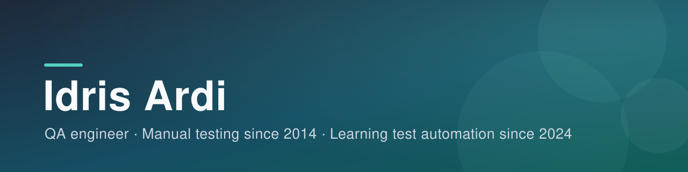

  

<h1 align="center">Hello, I'm Idris Ardi</h1>

  A QA engineer. I have been doing manual testing since 2014. 
  I started learning test automation in 2024, and I am still learning.

  

  
  
  
  

<h3 align="center">Tools I use</h3>

  

<h3 align="center">Learning test automation since 2024</h3>

  

  Playwright, Maestro, and k6 are part of my learning too. They just do not have icons here.

<h3 align="center">GitHub stats</h3>

  
  

<h3 align="center">Contribution snake</h3>

  <picture>
    <source media="(prefers-color-scheme: dark)" srcset="https://raw.githubusercontent.com/ardituran/ardituran/output/github-snake-dark.svg" />
    
  </picture>

<h3 align="center">Where to find me</h3>

  <a href="https://github.com/ardituran/idris-ardi-resume">Resume</a>
  &nbsp;&nbsp;|&nbsp;&nbsp;
  <a href="https://github.com/ardituran/hotel-planisphere-bdd-playwright-typescript">Automation portfolio</a>
  &nbsp;&nbsp;|&nbsp;&nbsp;
  <a href="https://www.linkedin.com/in/idrisardi">LinkedIn</a>
  &nbsp;&nbsp;|&nbsp;&nbsp;
  <a href="mailto:idris.ardi.qa@gmail.com">Email</a>

Thanks for stopping by.

